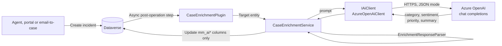

# dataverse-ai-plugin

[](https://github.com/mateusmirandaia/dataverse-ai-plugin/actions/workflows/ci.yml)

A Dataverse plugin that enriches new Dynamics 365 Customer Service cases with Azure OpenAI. When a case is created, the plugin reads its title and description and writes back four things an agent would otherwise work out by hand:

| Column | What it holds |
| --- | --- |
| `mm_aicategory` | One of a fixed set of categories (Billing, Technical Issue, Account Access, Product Question, Complaint, Feature Request, Other) |
| `mm_aisentiment` | Positive, Neutral or Negative |
| `mm_aisuggestedpriority` | High, Normal or Low, using the same values as the out-of-the-box Priority column |
| `mm_aisummary` | A 2-3 sentence summary written for an agent who has not read the case yet |

## The problem

Cases arrive from email, portals and phone calls with long, unstructured descriptions. Triage teams spend the first minutes of every case reading, categorising and deciding how urgent it is, and the categories they pick are inconsistent from one agent to the next. That makes routing slow and reporting unreliable.

This plugin does the first pass automatically, a few seconds after the case is saved. The AI output lands in its own columns, separate from the real Category and Priority, so a person (or a routing rule you trust) stays in control of the final decision.

## Architecture



The code is split so that each piece can be tested without Dataverse or the network:

- `CaseEnrichmentPlugin` is the thin `IPlugin` entry point. It validates the execution context (message, entity, depth, Target), reads the secure configuration and wires the services.
- `CaseEnrichmentService` holds the business logic: skip cases without a description, build the prompt, call the model, parse the reply and issue a single `Update`.
- `IAiClient` / `AzureOpenAiClient` wraps the Azure OpenAI REST API with `HttpClient`, a per-request timeout and retries on 429 and 5xx.
- `EnrichmentResponseParser` turns the model's JSON into a typed result and normalises anything outside the allowed values.
- `AzureOpenAiSettings` parses and validates the secure configuration.

There are no third-party runtime dependencies. JSON is handled with `DataContractJsonSerializer`, which ships with .NET Framework, so the assembly deploys as a single DLL with no ILMerge or dependent-assembly packaging.

## How it works

1. A case is created. The platform queues the async step.
2. The plugin checks it is running on `Create` of `incident` at depth 2 or less, and that `Target` is an entity. Anything else is traced and ignored, or rejected with a clear message.
3. If the case has no description, the plugin traces that and stops. A title alone is too thin to classify well.
4. The description is truncated to 4,000 characters and sent with the title to Azure OpenAI using `response_format: json_object`, `temperature: 0.2` and a 400-token cap.
5. The reply is parsed. Unknown categories become `Other`; unknown sentiment or priority values are left empty rather than guessed.
6. The plugin updates only the four AI columns on the case.

If Azure OpenAI is unreachable or returns an error, the plugin throws an `InvalidPluginExecutionException` with a readable message. The case itself is already saved; the failed system job shows what went wrong.

## Setup

### 1. Create the columns

Add these columns to the Case (`incident`) table in an unmanaged solution. If you use a different publisher prefix, update the constants in `src/CaseEnrichment/Enrichment/CaseColumns.cs`.

| Display name | Schema name | Type | Notes |
| --- | --- | --- | --- |
| AI Category | `mm_aicategory` | Single line of text | Max length 100 |
| AI Sentiment | `mm_aisentiment` | Single line of text | Max length 20 |
| AI Suggested Priority | `mm_aisuggestedpriority` | Choice (local) | High = 1, Normal = 2, Low = 3 |
| AI Summary | `mm_aisummary` | Multiple lines of text | Max length 2,000 |

Add them to the Case form (a read-only "AI insights" section works well) and to the views your triage team uses.

### 2. Sign and build the assembly

Dataverse only accepts strong-named plugin assemblies. The key file is not in the repository; create one once and keep it, because changing the key changes the assembly identity and forces you to re-register the plugin:

```powershell
# From a Developer Command Prompt for Visual Studio
sn -k src\CaseEnrichment\CaseEnrichment.snk
```

The project picks up `CaseEnrichment.snk` automatically when it exists. Then build:

```powershell
dotnet build DataverseAiPlugin.sln -c Release
```

The output is `src/CaseEnrichment/bin/Release/net462/MM.Dataverse.CaseEnrichment.dll`.

### 3. Register the assembly and step

Using the Plugin Registration Tool (`pac tool prt`):

1. **Register New Assembly**, select the DLL, isolation mode **Sandbox**, location **Database**.
2. **Register New Step** on `MM.Dataverse.CaseEnrichment.CaseEnrichmentPlugin`:

   | Setting | Value |
   | --- | --- |
   | Message | Create |
   | Primary Entity | incident |
   | Event Pipeline Stage | PostOperation |
   | Execution Mode | Asynchronous |
   | Run in User's Context | Calling User |
   | Delete AsyncOperation if StatusCode = Successful | Checked |
   | Secure Configuration | see below |

   Ticking the delete option keeps the system jobs table from filling up with one successful job per case.

### 4. Add the secure configuration

Paste a JSON object like [`samples/secure-config.example.json`](samples/secure-config.example.json) into the step's **Secure Configuration** box, with your own values:

```json
{
  "endpoint": "https://your-resource.openai.azure.com/",
  "deployment": "your-deployment-name",
  "apiKey": "your-azure-openai-key",
  "apiVersion": "2024-10-21"
}
```

`apiVersion` is optional and defaults to `2024-10-21`. The deployment should be a chat model that supports JSON mode (for example a `gpt-4o-mini` deployment).

Create a case with a description, wait a few seconds and refresh: the AI columns should be filled. If not, check **Settings > System Jobs** for the failed job, and the Plugin Trace Log (enable it under System Settings > Customization) for the plugin's trace output.

## Building and testing locally

```powershell
dotnet restore
dotnet build -c Release
dotnet test -c Release
```

The solution uses SDK-style projects with `Microsoft.NETFramework.ReferenceAssemblies`, so it builds with the .NET 8 SDK on any OS without Visual Studio or the .NET Framework targeting packs installed. The test project targets `net48`, so running the tests needs Windows (CI runs them on `windows-latest`).

Tests use xUnit and Moq. `IServiceProvider`, `IPluginExecutionContext` and `IOrganizationService` are mocked directly, the model is replaced with a fake `IAiClient`, and the HTTP client is tested against a stub `HttpMessageHandler`. They cover:

- secure configuration parsing and validation, including that errors never echo the key
- parsing of model replies: casing, unknown values, code fences, truncation, garbage input
- the service: the exact attributes sent to `Update`, skipping cases without a description, prompt construction, failure handling
- the plugin: message/entity filtering, depth guard, missing or wrong-typed Target, missing configuration
- the HTTP client: request shape and headers, retries on 429/5xx with `Retry-After`, no retry on 4xx, the API key never reaching the trace log

## Design decisions

**Why asynchronous, post-operation.** A synchronous step would make the agent wait on an external API every time they save a case, and any Azure OpenAI hiccup would roll back the create. Running async after the case is committed keeps saves fast and means a failed enrichment never loses data. The cost is a few seconds before the AI columns appear, which is fine for triage.

**Why secure configuration.** Secure configuration is stored encrypted, is only readable by system administrators, and is not exported with solutions, so the API key never ends up in source control or in a managed solution shipped to another environment. Each environment gets its own endpoint and key. The plugin never traces the key, and configuration errors are worded so the raw JSON is not echoed into system jobs.

**Sandbox limits.** Sandboxed plugins are killed after two minutes. The client uses a 30-second timeout per request and at most three attempts, with backoff capped at 10 seconds, so the worst case stays well inside the limit. A new `HttpClient` is created per execution with `Connection: close`, because the sandbox can recycle the worker process at any time and nothing should depend on static state. The plugin class itself only keeps the configuration string in a field, since Dataverse caches plugin instances and calls `Execute` concurrently.

**Updating only what changed.** The update sends a fresh `Entity` containing just the four AI columns. Echoing the whole Target back would overwrite anything an agent changed in the seconds since creation and trigger every update plugin and audit entry on those fields.

**Separate AI columns.** The model suggests; it does not overwrite Category or Priority. Keeping suggestions in their own columns makes it easy to measure how often agents agree with them before you let a routing rule act on them.

**Prompt design.** The system prompt gives a closed list of categories, a closed set of values for sentiment and priority, and short rules for when High is appropriate. The case text is wrapped in `<case>` tags and the model is told to treat it as data, which blunts the most obvious prompt-injection attempts from customer-written text. JSON mode plus a low temperature gives stable, parseable output, and the parser still validates everything rather than trusting the model.

**Cost and latency.** A typical case is a few hundred input tokens plus the system prompt, and the reply is capped at 400 tokens. Descriptions are truncated at 4,000 characters so a pasted email thread cannot blow up the bill. With a small model such as `gpt-4o-mini` this is a fraction of a cent per case and usually one to three seconds of latency. Token usage is written to the trace log for every call, which makes it easy to sample real costs.

## Roadmap

- Read the key from an Environment Variable of type Secret backed by Azure Key Vault, so rotation does not require editing the step.
- Support Microsoft Entra ID authentication (managed identity) instead of API keys.
- Map AI categories to the Subject tree or a custom category table instead of free text.
- Re-run enrichment when the description changes substantially (Update step with a filtering attribute and a guard against loops).
- Add language detection and store the detected language for routing.
- Ship the columns and step as a managed solution with a deployment pipeline.

## License

[MIT](LICENSE)
